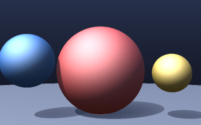
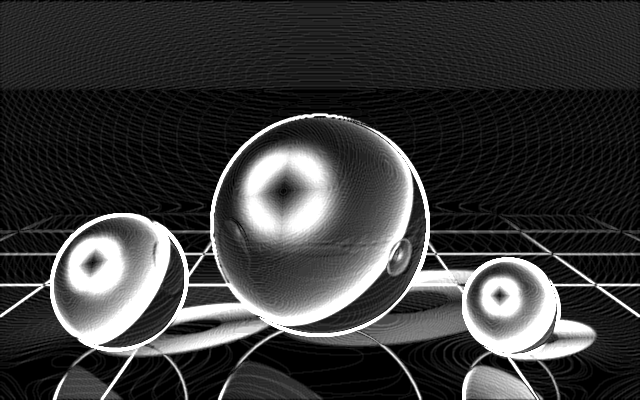
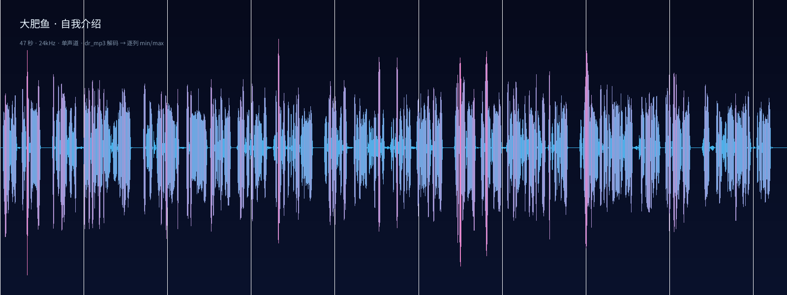

# 简言

一门**用中文写**的编程语言：中文关键字、仿 C 的骨架、半角符号。

目标很直接：让没学过 C 的人也能读写代码，同时跑得和 C 一样快、编出来的东西一样小。

```简言
函数 统计(文本: 借用 字符串) -> 映射[字符串, 整数] {
    私有 映射[字符串, 整数] 表 = {}
    对 词 在 std.string.分割(文本, " ") {
        表.插入(词, 1)
    }
    返回 表
}
```

---

## 现在有什么

| 目录 | 内容 |
|---|---|
| `规范/简言语言规范_v1.0.md` | 语言规范终稿：词法、类型、内存、并发、标准库、EBNF、体积与性能指标 |
| `规范/命名与产物.md` | 源文件后缀 `.jy`、二进制产物命名、ELF 标记、`.jym` / `.jyc` / `.jyd` |
| `规范/标准库_v0.2_网络与渲染.md` | 网络（TCP/UDP/DNS/TLS/HTTP）与基础渲染（画布/路径/文字/PNG） |
| `规范/标准库_v0.3_3D与增强2D.md` | **3D 全管线**（数学/网格/相机/软件光栅/光照/阴影/骨骼/GLB）+ **2D 扩展**（变换与裁剪栈/渐变/混合/路径布尔/排版） |
| `规范/标准库_v0.4_渲染与建模.md` | **可运行版**：距离场 + 光线追踪、面光软阴影、玻璃折射、ACES + 泛光、PNG 自编码、网格导出 |
| `规范/设计过程_续篇.md` | 设计推演过程，记录了每个决定的取舍理由 |
| `词法/` | **可运行的词法分析器**：C 实现 + Python 参考实现 + 可视化 |
| `语法/` | **可运行的语法分析器**：递归下降，产出语法树，带错误恢复与可视化 |
| `语义/` | **可运行的语义分析器**：符号表、类型检查、借用检查、可空分析、枚举穷尽 |
| `中间/` | **可运行的中间表示生成器**：三地址码、基本块、常量折叠、单态化 |
| `渲染/` | **可运行的渲染器与建模器**：读场景文件出 PNG、导出 OBJ/GLB，零依赖 |
| `后端/` | **可运行的编译器后端**：IR → C → 机器码；原生后端 IR → x86-64 汇编 → 自己的汇编器 → ELF |
| `手机/` | **能装到安卓手机上的 Playground**：IR 解释器 + JNI + WebView 编辑器，`构建.sh` 出一个 112 KB 的 APK |
| `教程/` | **入门教程**：16 章正文 + 14 个能跑的例子，`跑.sh` 把每个例子的输出逐字节比对 |

## 手机版：装到安卓上

`手机/` 里是一套能真装到手机上的东西：一个 WebView 写的编辑器，加一个把 IR
直接解释执行的引擎。产物是自签的 APK：

```bash
bash 手机/构建.sh          # → /workspace/简言.apk（112 KB）
adb install -r /workspace/简言.apk
```

为什么不是「把编译器交叉编译到 arm64」：手机上没有 gcc，也没有 as/ld，
原生后端自出的又是 x86-64 机器码。要让程序真的跑起来，只剩解释执行一条路。

为什么不用 NDK 编出来的二进制直接 exec：Android 10 起禁止对应用私有目录
`exec`，targetSdk 提到 29 以上就再也走不通。

| 手机版支持 | 手机版不接（会明确告诉你） |
|---|---|
| 整数 / 浮点 / 布尔 / 字符串 | 图片、声音（要渲染与音频设备） |
| 组、映射、结构、枚举 | 大数（独立库） |
| 函数、递归、闭包外的函数值 | 线程、通道（要 pthread） |
| 字符串方法、数学函数、结果类型 | 网络（要权限与事件循环） |
| `引入`（同目录相对路径） | |

跑起来长这样：点「运行」，代码在**子进程**里执行，输出接回界面。
子进程是为了隔离——解释器里全是裸指针，一段奇怪的程序就能把进程带走；
fork 之后它只死子进程，App 还能把「程序异常终止：信号 11」显示出来。

还加了一道闸：两亿条指令就停。手机上写个 `当 真 { }`，否则整个 App 会卡成一块砖。

## 教程：从零到能跑

规范是给实现者看的，五万字读下来还不会写第一行。所以另写了一份 [`教程/`](教程/)，
十六个章节，从"打印一行字"讲到"产物怎么小一半"，**每章配一个能直接跑的例子**：

| 章 | 一句话 |
|---|---|
| [0 开始](教程/00-开始.md) | 装什么、`make` 几秒、`-c` / `-n` / `-S` 三种停法 |
| [1 第一个程序](教程/01-第一个程序.md) | `模块`、`函数 主`、`打印行`，没有分号 |
| [2 变量与类型](教程/02-变量与类型.md) | 五种基本类型，`常量` / `不可变` / `私有` / `令` 四种写法 |
| [3 数字与运算符](教程/03-数字与运算符.md) | `/` 与 `//`、`<<` 是比较、15 级优先级全表 |
| [4 字符串](教程/04-字符串.md) | `#s` 取长度、`..` 拼接、12 个方法 |
| [5 条件与循环](教程/05-条件与循环.md) | `就` 不能省、`对 i: 1~10, 步长: 2`、`打断` / `继续` |
| [6 函数](教程/06-函数.md) | 表达式体、`借用` 与 `可变借用`、多返回值用结构 |
| [7 组与映射](教程/07-组与映射.md) | 组 11 个方法、映射 8 个方法、`.取` 为什么返回可空 |
| [8 结构与方法](教程/08-结构与方法.md) | 一行一个字段、`新建` 的三种写法、方法里"看不见的自身" |
| [9 枚举与匹配](教程/09-枚举与匹配.md) | 带数据的变体、`匹配` 必须穷尽、`默认` 兜底 |
| [10 泛型](教程/10-泛型.md) | `[T: 可比较]`、单态化为什么不是擦除 |
| [11 可空与结果](教程/11-可空与结果.md) | `.有值` / `.取值()` / `.或默认`，三种风格的取舍 |
| [12 大整数与小数](教程/12-大整数与小数.md) | 21! 就溢出、`0.1+0.2` 的真相、100 位 π |
| [13 图与声音](教程/13-图与声音.md) | `0xRRGGBBAA`、合成 440Hz、句柄语义为什么存在 |
| [14 编译与性能](教程/14-编译与性能.md) | 两条后端命令、16144 vs 9272 字节、六项基准 |
| [15 报错速查](教程/18-报错速查.md) | 按报错组织的六张表，加"这一版明确没接的九项" |

例子全在 [`教程/例子/`](教程/例子/)，期望输出在 [`教程/期望/`](教程/期望/)：

```bash
bash 教程/跑.sh
# ✓ 01-你好 … ✓ 14-后端
# 教程例子：过 14，错 0
```

写这本书的过程本身就是一次测试：每写一章就把那章的例子编一遍，编不过就是编译器有洞。
**这一轮因此补掉了六个洞**——`组` 类型后缀、字符串的元素类型、可空 `有值`、
`结果.或默认`、`循环` 里的 `打断`、结构方法（最大那个）。详见规范第 18 章。

想一口气读完，把它拼成单文件网页：

```bash
python3 教程/生成书.py     # → 教程/教程.html，124 KB
```

米色纸面、宋体正文、粘性目录，没有外部依赖，拷到哪儿都能读。

---

## 词法分析器

编译器第一步：把源码切成词。

```
源码   整数 甲 = 1 + 2
切完   [整数] [甲] [=] [1] [+] [2]
        关键字 名字 符号 整数 符号 整数
```

### 跑起来

```bash
cd 词法
make                 # 编译（gcc -O3 -flto，24 KB）
./简词法 示例/词频.简
```

输出：

```
   4:  1  关  模块    （结构）
   4:  4  标  词频
   4:  6  换  \n
   6:  1  关  引入    （结构）
   6:  4  标  std
   6:  7  符  .
```

`行:列 种类 原文`。种类：`关`=关键字、`标`=名字、`数`=整数、`浮`=浮点、`串`=字符串、`符`=符号、`换`=换行、`错`=错误。

### 实测数据

输入 18 MB 中文为主的简言源码（平均每 5 字节一个词）：

| 编译方式 | 体积 | 吞吐 |
|---|---|---|
| gcc `-O0` | 35 KB | 111 MB/s |
| gcc `-O2` | 27 KB | 440 MB/s |
| **gcc `-O3 -flto -s`** | **24 KB** | **502 MB/s** |
| musl `-Oz` 静态 | **37 KB** | 413 MB/s |
| musl `-O3` 静态 | 39 KB | 483 MB/s |
| Python 参考实现 | — | 1.6 MB/s |

- **37 KB 的静态二进制**，不依赖 glibc，拷到任何 x86-64 Linux 直接跑。同一个程序静态链接 glibc 要 705 KB——差 19 倍，全在运行库。
- **502 MB/s**，一秒切出约 1 亿个词。同一套规则的 Python 版慢 300 倍。

### 两份实现，互相验证

| | `lexer.c` | `lexer_参考实现.py` |
|---|---|---|
| 目的 | 快 | 好读 |
| 速度 | 502 MB/s | 1.6 MB/s |
| 规则 | 同一套 | 同一套 |

对同一份源码，两者输出**逐字节相同**（含错误提示的行列号与文案）。改规则时只改一边，`diff` 立刻暴露。

### 可视化

```bash
./简词法 -机器 示例/词频.简 > /tmp/tokens.txt
python3 生成可视化.py /tmp/tokens.txt 示例/词频.简 词法可视化.html
```

生成一张彩色网页，每个词按类型上色，悬停看行列位置。给没写过编译器的人看很直观。

### 想读懂代码

看 [`词法/词法分析说明.md`](词法/词法分析说明.md)。它假设你**完全没学过 C**，从"词法分析是什么"讲起，含 10 个 C 记号的速查表、代码地图、三个难点的图解。

---

## 语法分析器

编译器第二步：把词按层次叠成一棵树，同时检查"顺序对不对"。

```
整数 甲 = 1 + 2 * 3
→ [整数] [甲] [=] [1] [+] [2] [*] [3]
→ 变量 甲
     类型 整数
     二元 +
       整数 1
       二元 *
         整数 2
         整数 3
```

`*` 在 `+` 下面，所以先算乘法——**层次就是优先级**。

### 跑起来

```bash
cd 语法
make                       # 编译（连词法器一起编，因为它被 #include 进来）
./简语法 ../词法/示例/词频.简     # 打印整棵树
./简语法 -统计 示例/覆盖.简       # 只报节点数、深度、耗时
```

输出（节选）：

```
函数 统计
  参数 文本 [借用]
    类型 字符串
  类型 映射[字符串, 整数]
  块
    变量 表 [私有]
      类型 映射[字符串, 整数]
      数组字面量
```

缩进两格 = 孩子。行首是节点种类，后面是名字或原文，方括号是标记（`[借用]`、`[私有]`）。

### 实测数据

输入 8.4 MB 源码、216 万个词、每轮 104 万个节点：

| 编译方式 | 体积 | 吞吐 | 每秒词数 |
|---|---|---|---|
| gcc `-O0` | 120 KB | 35.4 MB/s | 930 万 |
| **gcc `-O3 -flto -s`** | **84 KB** | **68.6 MB/s** | **1798 万** |
| musl `-Oz` 静态 | **66.5 KB** | 35.2 MB/s | 924 万 |
| musl `-O3` 静态 | 87 KB | 41.8 MB/s | 1096 万 |
| Python 参考实现 | — | 1.26 MB/s | 30 万 |

对照：GCC 解析 C 约 1–5 MB/s，Clang 约 10–20 MB/s。**66 KB 的静态二进制、每秒 1800 万词**，够格做语言的地基。

快的五条原因：词先切进数组（不回头扫源码）、全篇只有一处回溯、词只记位置不复制字符串、孩子数组翻倍扩容、没有虚函数/异常/GC。

### 两份实现，互相验证

```bash
make 对答案
```

C 版和 Python 版各出一份树，`diff` 逐字节比对。`示例/覆盖.简`（153 行，把规范里的写法几乎写遍）必须零错误通过——现在是 **420 个节点、11 层深、0 错误**。

### 错误提示

报错要回答三个问题：在哪儿、错在什么、实际看到啥。

```
示例/覆盖.简:20:18: 语法错误：这里应该写 `{`（一块代码要用 { 开头），实际是 换行
  20 |     函数 面积() -> 浮点
                                    ^
```

出一次错就跳到行尾，不会一个括号引发十行连环报错。

### 可视化

```bash
./简语法 示例/覆盖.简 > /tmp/树.txt
python3 生成可视化.py /tmp/树.txt 示例/覆盖.简 语法树可视化.html
```

生成一张可折叠的树形网页，按"声明 / 语句 / 表达式 / 字面量"上色，能只看某一类、能看节点分布。

### 想读懂代码

看 [`语法/语法分析说明.md`](语法/语法分析说明.md)。假设你**没学过编译原理**：从"为什么要树"讲起，用 `1 + 2 * 3` 演示递归下降的调用链，附优先级全表、报错示例、以及**它现在还不能做什么**（诚实列了 7 条）。

---

## 语义分析器

编译器第三步：树搭对了，但话讲得通吗？

```
整数 甲 = "你好"       → 这里要 整数，给的是 字符串。简言不做隐式转换
打印(乙)               → 找不到 `乙`。是不是拼错了，或者忘了在这之前声明？
甲.名字 = "李四"        → `甲` 是不可变的（常量、不可变变量，或者是 `借用` 参数），不能改
```

### 跑起来

```bash
cd 语义
make                                # 编译（把词法、语法整个 include 进来）
./简语义 示例/正确.jy                # 0 错误 0 提示
./简语义 示例/错误.jy                # 16 个典型错误，一次全报出来
./简语义 -符号表 示例/正确.jy        # 顺便打印全局符号表
```

`示例/错误.jy` 的真实输出（节选）：

```
[错误] 第 39 行 第 8 列：初值类型和声明的类型对不上：这里要 整数8，给的是 整数。
       窄类型装不下宽类型，会悄悄丢数据。确实要截断就写 整数8(x) 这样显式转换
[错误] 第 50 行 第 8 列：`张三` 的值已经被移动走了（写 移动 或作为参数传走），这里不能再用。
       要保留就写 `复制 张三`
[错误] 第 53 行 第 29 列：`王五` 正被别人借着看，不能同时可变借用。等那句用完再改
[错误] 第 56 行 第 10 列：这是 可空[学生]，可能为空，不能直接取 `.名字`。
       先写 如果 它 != 空 就 { ... }，或者写 它.取值()
[错误] 第 64 行 第 5 列：`匹配` 没有处理 `绿、蓝`，也没写 默认。枚举必须穷尽，补上缺的分支，或者加一行 `默认: { ... }`
```

每条都说清**要什么、给了什么、怎么改**，不是一句"类型不匹配"。

### 它查什么

| 检查 | 例子 |
|---|---|
| 名字存在 | `打印(乙)` → 找不到 `乙` |
| 类型相容 | `整数 甲 = "文字"` → 要整数给字符串 |
| 参数个数与类型 | `加法(1, 2, 3)` → 要 2 个给了 3 个 |
| 返回值 | `-> 整数` 的函数 `返回 "文字"` |
| 不可变性 | 改常量、改 `借用` 参数 |
| 借用冲突 | 同一句里既 `借用` 又 `可变借用` |
| 移动后使用 | `移动 甲` 之后再用 `甲` |
| 可空 | 未判断 `!= 空` 就取字段 |
| 枚举穷尽 | `匹配` 漏了变体 |
| 接口契约 | `实现 X 为 Y` 少写了方法、签名不一致 |
| 作用域 | 同一层重名、找不到类型 |
| 控制流 | `打断` 不在循环里、有返回类型但某条路不返回 |

### 实测数据

输入一份 564 KB / 16 万词 / 14 万表达式的源码（词法 + 语法 + 语义全流程）：

| 编译方式 | 体积 | 吞吐 | 每秒表达式 |
|---|---|---|---|
| **gcc `-O3 -flto -s`** | **119.9 KB** | **62.9 MB/s** | **1596 万** |
| musl `-Oz` 静态 | **100.2 KB** | — | — |
| musl `-O3` 静态 | 134.1 KB | — | — |

单份 2.8 KB 的小文件，一次完整分析 **0.13 毫秒**。

### 两份实现，互相验证

```bash
make 对答案      # 两份实现输出完全一致
```

| | `sema.c` | `sema_参考实现.py` |
|---|---|---|
| 类型 | 结构体 + 指针 + 去重池 | 元组，`==` 就是同构比较 |
| 分派 | `switch` 大函数 | `dict` 分派表 + 小方法 |
| 符号表 | 链式作用域 + 哈希桶 | `list[dict]` |

### 想读懂代码

看 [`语义/语义分析说明.md`](语义/语义分析说明.md)。讲清"为什么分两遍""类型怎么表示""借用为什么只活一句""可空怎么做流敏感"，并**诚实列了 5 条 v0.1 明确不做的**。

---

## 中间表示与单态化

编译器第四步：树搭对了、类型也对了，但树是给人看的，机器读不了。
这一层把它摊平成一串指令，顺手把泛型展开、把能算的算完。

```简言
函数 最大[T: 可比较](甲: T, 乙: T) -> T {
    如果 甲 >> 乙 就 { 返回 甲 }
    返回 乙
}
```

用到两种类型，就生成两个专用版本，运行时零开销：

```
函数 最大$整数(甲: 整数, 乙: 整数) -> 整数
L0:
    %t2 = 载 %甲
    %t3 = 载 %乙
    %t4 = 大于 %t2, %t3 : 布尔值
    条件跳 %t4 则 L1 否则 L2
L1:
    %t5 = 载 %甲
    返回 %t5
L2:
    %t6 = 载 %乙
    返回 %t6
```

### 跑起来

```bash
cd 中间
make
./简中间 示例/泛型.jy        # 看 IR
./简中间 -统计 文件.jy        # 只看数字
./简中间 -不折叠 文件.jy      # 关掉常量折叠，对比着看
make 比折叠                  # 两边并排
```

### 常量折叠

`2 * 3 + 4 * 5 - 6 // 2 + (2 ^ 10)` → `常量 1047`，16 条指令变 2 条。

### 单态化

| 调用 | 生成的实例 |
|---|---|
| `最大(1, 2)` | `最大$整数` |
| `最大(1.5, 2.5)` | `最大$浮点` |
| `最大("abc", "abd")` | `最大$字符串` |
| `三个最大(3, 9, 5)` | `三个最大$整数`（内部又调 `最大$整数`） |

队列式展开：实例化出来的函数体里再遇到泛型调用，继续入队，直到队列空。

### 实测数据

输入 347.8 KB / 9.8 万词：

| 编译方式 | 体积 |
|---|---|
| gcc `-O3 -flto -s` | **163.9 KB** |
| musl `-Oz` 静态 | **146.8 KB** |

| 指标 | 数值 |
|---|---|
| 吞吐 | 54 MB/s |
| 指令生成 | 790 万条/秒 |
| 单份小文件 | 0.05 毫秒 |

### 可视化

```bash
make 可视化     # 生成 示例/泛型_中间表示.html 和 覆盖_中间表示.html
```

每个函数一张卡片，每个基本块一个框；竖条颜色标出指令品类（算术蓝、调用橙、跳转黄、返回红）。
块标签 `L3` 可点，直接跳到对应块——查"这个跳转到底跳到哪"时比翻文本快。

### 这一棒只有 C 版

前四棒都写了 Python 参考实现来对答案。这一棒没有，原因很直白：
**IR 的输出格式还在变**，写两份只会让每次改动都要改两处。
等格式稳定到出机器码那一棒，再补参考实现。

### 想读懂代码

看 [`中间/中间表示说明.md`](中间/中间表示说明.md)。讲清"为什么要有基本块""为什么不做 SSA""单态化的代价""控制流怎么摊平"，
以及 v0.1 明确不做的 5 条优化。

---

## 后端：终于能跑了

前四棒加起来一万五千行，但从没有一个 `.jy` 文件被执行过。这一棒把它接通。

```bash
cd 后端 && make
./简编译 示例/排序.jy -o 排序 && ./排序
```

```
排序前：[42, 7, 19, 3, 88, 56, 21, 9]
排序后：[3, 7, 9, 19, 21, 42, 56, 88]
查找 21 的位置：4
```

### 它干什么

```
.jy 源码 → 词法 → 语法 → 语义 → IR → C → gcc → 机器码
                                    └── 这一棒
```

每条 IR 指令翻译成一条 C 语句，每个基本块变成一个 C 标签，块之间全靠 `goto`：

```
%t3 = 加 %t1, %t2 : 整数     →     v3 = v1 + v2;
条件跳 %t5 则 L2 否则 L3       →     if (v5) goto L2; else goto L3;
```

值不复用，每条指令一个变量。一个函数能有几百个局部变量——然后 gcc -O2 的寄存器分配把它们全消掉。

**这是有意的欠债**：现在偷的懒，就是原生后端将来要补的活。但它让整条链路在一天内通了起来。

### 为什么不出机器码

原本的计划是直接写 x86-64。真动手时改了主意：

> 第一次跑崩了，你分不清是 IR 错了、指令选错了、还是寄存器分配错了。

这一轮从 IR 里挖出七个 bug（见规范第 6 节），全都是「没跑过就不知道」的类型。先出 C，让 gcc 承担最难的两块，bug 就只可能出在自己这层。

### 用简言写的光线追踪器

[`后端/示例/光线.jy`](后端/示例/光线.jy) 是 365 行简言。640×400、2×2 超采样、
真平面地板、软阴影、地板倒影、接触阴影、ACES 近似定影，**0.10 秒**，直出 PNG：



v0.7 之前这段代码里有个手写的开方，32 次牛顿迭代：

```简言
函数 开方(x: 浮点) -> 浮点 {
    私有 浮点 猜 = x
    私有 整数 i = 0
    当 i << 32 就 { 猜 = (猜 + x / 猜) * 0.5; i = i + 1 }
    返回 猜
}
```

后来把 libm 接进来，删掉这个函数：

| | 640×400 × 2×2 |
|---|---|
| 手写牛顿迭代 32 次 | 0.85 秒 |
| libm `sqrt` | **0.10 秒** |

**8.5 倍**，输出逐字节一致。这就是"引第三方库"最直白的样子：
不是加功能，是把一段自己写得很累、别人写得很好的代码换掉。

第一版不是这样——球是悬空的。查下去是三个独立的错：地板是颗放大两百倍的球（没法算接触阴影）、
软阴影把"半弦长"当成了"垂距"（阴影被抹平）、球心 y 是手写的（球底离地半个球高）。
第三个最好笑，也最值得记：**几何上没落地，光照算得再对也白搭。**

### 换一种画法：直接吐 SVG

3D 是自己算像素，2D 换个路子：输出 SVG。坐标、贝塞尔、渐变全是文本，
会 `打印` 字符串就会画图——没有画布、没有上下文、没有状态机。

[`后端/示例/绘图.jy`](后端/示例/绘图.jy) 390 行，画一张 1200×750 的矢量海报，
山脊是伪随机数滚出来的，波光按距离算，船、鸟、星星都是算出来的路径。成品 **19 KB**：


第一版的三层山被画成了一片起伏的雾——峰太矮、太缓，还被二次曲线削圆了。
有人看了一眼说："你不说这是山，我还以为是太阳光。" 于是重画：

- 山脊改成折线，每座峰是「肩 → 顶 → 下切 → 谷」四笔，**每三座里有一座主峰**拔高；
- 远山不再用透明度假装空气透视，直接给一个被大气"洗过"的实色；
- 加 `垭口(x)`：太阳左右 190 像素内把振幅压到 20%，太阳正好落在山口里；
- 水面加一条山影——山要"伸进"水里，不能"站"在水上。

倒影也重写了。上一版每行撒四段、位置各自随机，行距又用 `t*t`，
前二十行全挤在地平线上一两个像素里，叠成一根死亮的竖条，看着像座塔。
现在每行只画一条主光斑，两侧碎光从主光斑往外推，两成的行干脆不画——
水面的反光本来就是断断续续的。

### 让它动起来

还是那个光线追踪器，只把相机绕场景转一圈：每帧 6°，六十帧正好一整圈。
光源钉死在世界上不动，影子就会从球身上扫过去。


没有 `sin`/`cos` 怎么转？用旋转矩阵连乘：`x' = x·c − z·s`，`z' = x·s + z·c`。
6° 的 c、s 是常数，写死在源码里，每帧转一步，六十步后半径误差不到万分之一。
**语言里没有三角函数库，那就别求角度——求增量。**

帧数据也不是什么特殊格式：每帧前面打一行 `帧 N`，后面接一张标准 PPM，
拆帧脚本按这行切，剩下的交给 ffmpeg。

```bash
cd 后端 && bash 出图.sh      # 一次出齐：静帧、海报、动画
```

### 实测

| 指标 | 数值 |
|---|---|
| 后端自身 | 2022 行 C99（含内嵌运行时） |
| 二进制 | 208 KB |
| 编译（含 gcc） | 30 ms |
| 光线追踪 640×400 | 0.84 秒（含一次反射） |
| 矢量海报 1200×750 | 19 KB SVG，瞬时 |
| 转台动画 60 帧 480×300 | 25 秒 |
| 测试 | 28 个用例，`make 测试` 逐字比对 |
| 手机版 | 22 个用例对拍 + 6 个「明确不支持」的边界检查 + 执行链路自测 |

已经能写：函数/递归/泛型单态化、`如果`/`当`/`对`/`匹配`、结构体（`新建 点{...}` 构造）、
枚举解构、组、映射、字符串全套、`结果`、通道、模块级 `常量`。

还不能写：闭包捕获外层非通道变量（线程已是真的，外层变量只读）。

全部细节见 [`规范/后端_v0.5_C参考后端.md`](规范/后端_v0.5_C参考后端.md)。

---

## 把第三方 C 库接进来

一门语言"能不能画图"，跟"画得好不好"，中间隔着的不是语法，是**库**。

到 v0.6 为止，简言只会输出：PPM 要 convert 转，SVG 要 cairosvg 转。
链子上它只负责前半截。v0.7 换了个做法：把别人写好、被用过几百万次的那份拿过来。

| 库 | 做了什么 | 代码量 |
|---|---|---|
| `stb_image` | 读 PNG/JPG/BMP/TGA/GIF/PSD/HDR，统一转 RGBA8 | 27 万行 |
| `stb_image_write` | 写 PNG/JPG/BMP/TGA | 8 万行 |
| `stb_truetype` | 字体光栅化，中文没问题 | 20 万行 |
| `nanosvg` + `nanosvgrast` | 解析并栅格化 SVG | 12 万行 |

一行 C 都没重写。源码 vendor 在 [`第三方/`](第三方/)，不靠包管理器，不联网：

```bash
cd 第三方 && make        # 3.5 秒，一次性，产出 lib简言图.a（321 KB）
cd ../后端 && make 出图
```

### 关键决定：库不进生成的 C

`stb_image.h` 展开实现后 27 万行。每个 `.jy` 都带一遍，编译时间就从 30 ms 涨到一秒多，
而绝大多数程序根本不碰图片。

所以切成两半：实现编成 `lib简言图.a`，生成的 `.c` 里只留六行 `extern` 声明。
不碰图片的程序，那 321 KB 连进都不进二进制。

`简编译` 从 `/proc/self/exe` 找自己的目录，依次试 `../第三方/`、`./`、`./第三方/`；
找不到就不链接——纯计算程序照样编，用到 `图` 时才在链接阶段报错，错误信息里带着解法。

### 现在能这么写

```简言
私有 图 甲 = 新建图(1200, 750)
甲.设(0, 0, 0xFF0000FF)
私有 图 乙 = 甲.缩放(600, 375)
甲.写字(88, 250, 168.0, "简言", 0xFFFFFFFF)
私有 结果[空值, 字符串] r = 甲.存("封面.png")      -- 按扩展名选 png/jpg/bmp/tga

私有 结果[图, 字符串] 读 = 读图("照片.jpg")        -- 读进来就是 RGBA8
```


这张封面是 [`示例/封面.jy`](后端/示例/封面.jy) 画出来的：从一张空白像素缓冲开始，
自己算渐变、自己画环、自己排字，不经过 SVG，不经过浏览器，不经过任何画图程序。
**1200×750，0.06 秒。**

### 读图之后能做什么

[`示例/滤镜.jy`](后端/示例/滤镜.jy) 把上面那张光线追踪读进来，做三种效果：

| 高斯模糊 | Sobel 描边 | 色调分离 |
|---|---|---|
|  |  |  |

3×3 卷积、边缘检测、分段量化，全是像素循环里手写的。三个效果各 25 万像素，**一共 0.09 秒**。

### 试过但没要

**mimalloc**：把 `static.c` 编成 `.o`，`-DMI_MALLOC_OVERRIDE=1` 覆盖 `malloc`，
链进 30 万次字符串拼接 + 100 万次数组追加的基准。结果 **0.03 秒 vs glibc 的 0.02 秒，
内存 42 MB vs 37 MB**——更慢，还更占内存。

原因不在 mimalloc，在简言的运行时：分配出来的旧内存从来不释放。
分配器再快也只是分配快，这个负载的瓶颈根本不在分配路径上。
真要提速该改运行时（引用计数或区域回收），不是换个分配器。

**utf8proc**：2.4 MB 的 Unicode 表，换 `大写`/`小写` 的正确性。中文没有大小写，
先不背这个体积。

### 顺带修的一个真 bug

`结果[T, E]` 的载荷是一块 `char *`：存的时候按一头算宽度，取的时候按**另一头**拷。

```c
简_果造(1, &图值,   sizeof(简图))    /* 24 字节 */
简_果造(0, &错信息, sizeof(简字))    /* 16 字节 */
```

于是 `读图()` 失败时，16 字节的字符串被当成 24 字节拷出去，**多读的 8 字节是堆上相邻的内容**。
这个 bug 在 `结果[整数, 字符串]` 这种两头一样宽的场景里永远不出现，
一直等到 `结果[图, 字符串]`（24 vs 16）才露头。

修法：载荷固定 128 字节 `calloc`，取用时按 `min(载荷宽, 目标宽)` 拷。
多占 112 字节，换掉一整类"结果偶尔是随机数"的悬案。

### 别人拿到，能不能编

vendor 进仓库的理由只有一个：**别人 clone 下来直接能编**。这一条不验证，前面全是本机能跑。

所以最后一步是把远程仓库的 109 个文件逐字节核对一遍，再铺到一个空目录里从零构建：

| 检查项 | 结果 |
|---|---|
| 远程 109 个文件 vs 本地 | **109 相同，0 不同** |
| 空目录里的 `.o` / `.a` | **0** 个（源码干净） |
| `make` | **6.97 秒**，其中第三方库 3.5 秒 |
| `make 测试` | **10 通过，0 失败** |
| 重出光线 / 封面 / 三张滤镜 | sha256 与仓库内版本**完全一致** |

最后一行比前三行都重要：五张图的哈希一致，说明 stb 解码、字形栅格化、双线性缩放、
PNG 编码整条链路是**确定性**的——没有时间戳、没有随机种子。以后改渲染器，
"画面到底变没变"才有得比。

细节、边界、许可证见 [`第三方/说明.md`](第三方/说明.md)。

---

## 数字：int64 装不下的东西

`20!` 就已经溢出了 int64。这类问题不该靠"小心点"解决，所以接了两个数字库：

| 目录 | 库 | 许可证 | 提供什么 |
|---|---|---|---|
| `第三方/tommath/` | [libtommath](https://github.com/libtom/libtommath) `45402fd` | 公有领域 | 任意精度整数，154 个 `.c` |
| `第三方/mpdec/` | [mpdecimal](https://www.bytereef.org/mpdecimal/)（CPython 内嵌版） | MIT | 十进制浮点，15 个 `.c` |

不选 GMP 的理由很实际：它是 LGPL，静态链接进分发物有连带义务；
这两个都是"随便用"。性能差一点，但算 1000! 只花 0.01 秒，人感觉不到。

### 它们算出来的东西

```
20!  2432902008176640000   （int64 上限 9223372036854775807）
1000! 位数 2568  Stirling 估 2568
1000! 末尾 0 的个数 249
2^10000 位数 3011
F(1000) 位数 209

π 的 100 位（Machin 公式，用小数算的）：
3.141592653589793238462643383279502884197169399375105820974944592307816406286208998628034825342117068
```

π 那一行没有调任何"算 π 的库"，只有泰勒级数展开 `atan(1/x)` 和 1706 年的公式
`π/4 = 4·atan(1/5) − atan(1/239)`，全用 `小数` 算出来的。

最后一组对比最说明问题：

```
  小数累加 10 次 = 1.0
  浮点累加 10 次 = 1   与 1.0 的差 ×1e17 = -11.1022
```

`0.1` 加十次，十进制给 `1.0`，二进制给 `0.9999999999999999`。
这不是精度位数不够——加到 1000 位也一样，是十进制与二进制之间的事。

### 顺带拆掉的两个静默截断

接这两个类型时撞上两个老 bug，都属于"不报错，只是少了一半数据"：

1. **数组字面量只有前 8 个。** 八个音符的旋律写十六个音，跑出来报
   `下标越界：8，长度 8`。根因是 IR 的 `指令.多[8]` 写死，降级循环
   `i < 子数 && 数 < 8` 把多余的直接丢掉。改成动态数组。
2. **`整数 * 浮点` 被算成整数。** `i * 1.0 / 率` 得 `0`，因为
   `表达式类型()` 的二元分支只看左操作数。这个 bug 活得久，是因为
   `宽 / 2.0` 只是变成整除，画面差半个像素，肉眼看不出来。

第二个顺手澄清了一条语言约定：**`/` 永远是浮点除法，整除写 `//`**。

---

## 声音：把它当数组看

图片是 `x*y*4` 个字节，声音是 `帧*声道` 个浮点。既然是数组，合成就不需要音频引擎。

| 目录 | 库 | 许可证 | 提供什么 |
|---|---|---|---|
| `第三方/dr/` | [dr_libs](https://github.com/mackron/dr_libs) 的 `dr_wav.h` + `dr_mp3.h` | 公有领域 / MIT-0 | WAV 读写、MP3 解码 |

没要 miniaudio：它 5 MB，解码、混音、播放全有，但**沙箱里没有声卡，
播放那一半我一行都验证不了**。验证不了的东西不进语言。

### 合成一段 8 秒的循环

`后端/示例/声音.jy` 里只有三样东西：分音（基频 + 二次 0.3 + 三次 0.15）、
包络（前 2% 起音，之后 `pow(0.001, t)` 指数衰减）、55Hz 的低音铺底。
十六个音、A 小调五声音阶，192000 帧，0.01 秒跑完。

回声那段有个坑值得记：**不能原地叠**。

```简言
私有 声音 干 = 轨.放大(1.0)      -- 先拷一份
当 i << 总帧 就 {
    私有 整数 源 = i - 延迟
    如果 源 >> -1 就 { 轨.混(i, 0, 干.取(源, 0) * 0.3) }
    i = i + 1
}
```

直接读 `轨` 自己，混进去的样本会被下一帧读到，再混一次……反馈滚起来，
最后是一坨越来越响的噪声。

### 把 47 秒画成一张图

`示例/声画.jy` 读一段 MP3，每一列吃掉约 705 帧，取这一段的 **min 与 max**
（不是平均——平均会把语音的峰值全压平），按幅度从青染到粉：

```
帧数 1128384  时长 47.016 秒
已存 出图/声纹.png
```



七句话之间的换气口在图上是一条条细缝。这是"声音 + 图片"第一次接起来：
MP3 解出来的 float 数组，直接当像素来源，中间没有中间格式、没有临时文件。

### 一个错误处理路径自己的 bug

越界检查生成的 C 长这样：

```c
fprintf(stderr, "下标越界：94209000094144，长度 94209000239902\n", (long long)i, (long long)n);
```

数字焊进了格式串。原因是写运行时的 `行(const char *格式, ...)` 自己是 `vfprintf`，
源码里那个 `%lld` 先被 `行` 吃掉了。改成 `%%lld` 才好。

这个 bug 藏了很久，因为只有真越界时才走到那行——**而一个坏掉的错误处理，
比没有错误处理更难发现**。

---

## 听音：看不见的声音，就量出来

`峰值 0.98` 能说明没坏，说明不了好不好。所以我给简言加了个「听音」——
把 wav/mp3 读成一份**文字**报告，读完就知道这段音频是什么、对不对。

八秒的主题曲：

```
║ 响度  峰值 -0.18 dBFS · 均方根 -14.52 dBFS · 峰均差 14.3 dB
║ 体检  ✓ 无削波  ✓ 无直流  ✓ 有信号
║
║ 能量  ▇▆▅▅▆▅▅▇▇▆▆▆▆▆▆▇▇▆▆▆▆▆▆▇▆▆▅▆▅▅▅▇▆▅▅▅▅▄▆▇▆▅▅▅▄▄▆▇▅▄▅▅▄▄▇▆▅▅▅▅▅▅▇▆
║ 音高                                 ▅       ▄      ▄▄      ▄▄      ▅
║ 起音  █··▁···▂·······▂·······▂·······▃···▁··▄▁··▂▁··▄▁··▂···▅···▁···▂···▁···
║       |-----------|-----------|-----------|-----------|-----------|----  竖线 = 1 秒
║
║ 起音  14 个 · 平均 1.75 个/秒 · 平均间隔 0.501 秒（约 120 BPM）
║ 音级  A  ▮▮▮▮22%  C  ▮▮▮▮▮▮▮37%  D  ▮▮▮▮19%  E  ▮▮▮ 15%  G  ▮   7%
║
║ 判读  音高抖动 0.23%/帧 · 清晰度 0.84 · 发声占比 98.4%
║       → 音乐（音高成台阶，起音 1.8 个/秒）
```

对照 `示例/声音.jy` 里写的 `{0,3,5,7,5,3,0,3,7,10,12,10,7,5,3,0}`：
**120 BPM、A 小调五声（A C D E G，一个外音都没有）、十六个音**。
检测到 14 个——漏了两个，报告里就写漏了两个，不装。

七句的语音读出来是：

```
║ 分段  7 段 · 发声占比 88.1%
║  #01   0.17→  2.39  2.22s F4   B3  –A4  降 清晰 0.91 亮 1.3k
║  #02   3.11→  7.79  4.67s E4   A3  –A4  平 清晰 0.90 亮 1.5k
║  #03   8.55→ 18.67 10.11s E4   A3  –A4  平 清晰 0.90 亮 1.8k
║  …（共 7 段）
║ 停顿  6 处 · 0.73s 0.77s 0.70s 0.75s 0.73s 0.81s
║       → 语音（音高连续滑动，抖动 2.2%/帧）
```

七段、六处停顿、每处 0.7–0.8 秒——**规整得一眼就知道不是人读的**。
音高在 A3–A4 之间滑动，每段都「降」收尾，主语调在陈述。

### 那份报告怎么算的

1024 点帧、50% 重叠、FFT 补零到 2048；基频用 YIN 的累积均值归一化差分；
起音用能量一阶差分；分段按 `峰 − 30dB` 切静音。全部读完 0.19 秒。

路上踩了三个连着的坑，都是「看起来对、结果差一个八度」的那种：

1. **循环自相关** —— `|X|²` 逆变换会绕回来和另一端相关，补零到两倍才干净。
2. **加窗把自相关压塌了** —— 纯 110Hz 加 Hann 窗后 `R(218)/R(0)` 只有 0.74，
   怎么调阈值都认不出来。修法是**自相关之前不加窗**，窗只留给频谱。
3. **取最大峰必然一半机会错八度** —— 440Hz 被老老实实报成 A3(220)。

第三种试了几版才对，最后落在 YIN 上。三种输入一次过：

```
440Hz 正弦          -> 441
110Hz 正弦          -> 111
440+880 复合        -> 441        ← 没有掉到 220
```

**110 是最难的低音，440+880 是最容易掉八度的复合音**，这两行过了才算数。

### 修掉了两个一直躲着的 bug

**一、`当 a 与 b 就` 死循环。** 生成的 C 里条件跳丢了，第一个条件算完就
掉进循环体。拆开看是三个错叠在一起：

| 错 | 表现 | 修法 |
|---|---|---|
| 块的位置 | 短路的「右块/汇合块」被追加到函数末尾，循环体往上补了一位 | 新增 `接块()`，插在当前块之后 |
| 条件跳发错块 | `加块` 顺手改了「当前块」，条件跳落进汇合块，成了 `if (v10) goto L4 else L5` 卡在自己身上 | 记下左块，造完两块再切回去发 |
| 默认值方向反了 | `与` 短路时取「真」，于是 `a 与 b` 在 a 假时反而得真 | `与 → 假`，`或 → 真` |

只修其中任意两个都还是死循环，所以这轮之前怎么改都不动。

**二、`r.取值.归一化()` 类型退化。** `取值`、`长度` 这类零参属性查出来的
是「函数签名」，写成不带括号时值应该是返回类型。语义层一直这么处理，
IR 的 `表达式类型()` 漏了，于是 `r.取值` 成了函数值，再往上找方法就找不到，
C 里拿 `long long` 去接 `简声`。

现在 `测试/短路.jy` 和 `测试/链式.jy` 钉着这两条。

---

## 渲染：能出图了

前四棒都是"把源码变个样子"。这一棒换个方向：**让程序吐出像素**。

`渲染/` 是一个能跑的渲染器。给它一个场景文件，它出一张 PNG；同一份文件，还能导出 3D 模型。

```bash
cd 渲染
make
./简渲 示例/静物.scene -o 静物.png        # 900×560 / 128 采样，约一分钟
./简渲 示例/静物.scene -预览               # 320×200 / 16 采样，0.7 秒
./简渲 示例/小岛.scene -模型 小岛          # 出 小岛.obj + 小岛.glb
```


### 场景文件就是空格版的函数调用

```简言
球(位置: (0, 0.85, 0), 半径: 0.85, 材质: "白瓷")
```

去掉括号冒号，就是场景文件：

```
球 (0, 0.85, 0) 0.85 材质 白瓷
盒 (0, -0.12, 0) 大小 (5, 0.12, 5) 圆角 0.05 材质 哑光白 名字 台面
盒 (0, 3.0, -1.9) 大小 (7, 5, 0.35) 圆角 0.35 材质 哑光白 平滑并 台面 2.6
光 面 (1.9, 2.7, 1.9) 大小 (1.4, 1.8) 看向 (0, 0.9, 0) 强度 26
```

三条规矩：**键可以省**（`球 (0,0,0) 0.5` 等价于写全）、**键可以换序**、**一行一个东西**（删一行不影响别的行）。

为什么不用 JSON：AI 少写一个逗号整份文件就废了。这里少写一个参数，只是那个参数取默认值。

### 四张示例

| 静物 · 产品图 | 小岛 · 程序化建模 |
|---|---|
|  |  |
| 无缝背景、三层布光、三种材质 | 盒 + 球 + 圆柱拼出来的，同一份文件导出 GLB |

| 材质 · 玻璃与金属 | 几何 · 粉彩插画 |
|---|---|
|  |  |
| 玻璃折射、铬镜面、金、磨砂玻璃 | 长焦压缩透视、低饱和配色 |

### 它怎么画

不用三角形，用**符号距离场**：

```
球     距(p) = |p - 球心| - 半径
并集   min(a, b)
差集   max(a, -b)
平滑并 mix(a, b, k)        ← 交界处自动长圆角
```

于是"一个带槽的空心杯"是这样写的：

```
圆柱 (0, 0.5, 0) 半径 0.4 高 0.5 材质 白瓷 名字 筒
圆柱 (0, 0.6, 0) 半径 0.3 高 0.6 材质 白瓷 差 筒
盒   (0, 0.35, 0) 大小 (0.5, 0.1, 0.05) 材质 白瓷 差 筒
球   (0, 1.05, 0) 半径 0.2 材质 白瓷 平滑并 筒 0.08
```

用三角形写，这是几百行顶点数据；AI 也编不出来。

代价是慢 3~10 倍，用多线程和采样数补。换来的是：法线天然光滑、软阴影免费、AO 免费、反射折射就是再发一条射线、代码少三分之二。

### 光照

| | 做法 |
|---|---|
| 直接光 | 面光源采样 + 距离场估半影（**软阴影**） |
| 环境 | 三段天空渐变 × **环境光遮蔽**（落地感全靠它） |
| 反射 | 粗糙度 < 0.5 追射线（磨砂金属），否则用天空近似（压噪点） |
| 玻璃 | Fresnel 选反射/折射，内部走**内部求交**，Beer 吸收给体感 |
| 成像 | 泛光 → 曝光 → 暗角 → ACES → sRGB |

### 导出 3D 模型

距离场 → 三角网格用 marching tetrahedra（不用 marching cubes：少一张 256 项的表，不会破面）。

```bash
$ ./简渲 示例/小岛.scene -模型 小岛
导出 188665 顶点 / 155612 三角形 → 小岛.obj、小岛.glb
```

0.4 秒。`.obj` 拖进 Blender，`.glb` 拖进 Three.js。

### 实测

900×560 / 128 采样 / 4 核：

| 场景 | 物体 | 时间 | PNG |
|---|---|---|---|
| 静物 | 5 | 63 秒 | 588 KB |
| 小岛 | 10 | 191 秒 | 629 KB |
| 材质 | 5 | 226 秒（160 采样） | 660 KB |
| 几何 | 7 | 68 秒（144 采样） | 509 KB |

- 二进制 **108 KB**（`-O3 -flto -s`，动态链接，含 pthread）
- 预览 320×200 / 16 采样：**0.7 秒**
- 网格导出 96 精度：**0.4 秒 / 15.5 万面**
- 零依赖：自己写 PNG（LZ77 + 固定哈夫曼）、自己写 OBJ/GLB、自己写噪声

### 两份渲染，各管一段

| | `规范/标准库_v0.3_3D与增强2D.md` | `渲染/` |
|---|---|---|
| 是什么 | 设计：2D 变换栈/路径布尔/排版，3D 光栅管线/骨骼 | 实现：距离场光线追踪 + 建模导出 |
| 状态 | 未实现 | **能跑** |

那一版的 2D 和三角形光栅还没写，但设计留着——等后端能编译简言、能加载 GLB 之后，
静态网格走光栅、程序化形状走距离场，两条路并存。

想看 v0.3 的 2D 与光栅设计长什么样，打开 [`规范/渲染演示.html`](规范/渲染演示.html)：
纯 JS 预览，右侧立方体是逐像素写 `ImageData` 出来的，没有 WebGL。

全部细节见 [`规范/标准库_v0.4_渲染与建模.md`](规范/标准库_v0.4_渲染与建模.md)，
四张图加场景源码的相册在 [`渲染/渲染画廊.html`](渲染/渲染画廊.html)。

---

## 文件叫什么

| 东西 | 后缀 | 说明 |
|---|---|---|
| 源码 | `.jy` | 也认 `.简`，但会提示建议改成 `.jy` |
| 模块接口 | `.jym` | 类比 C 的 `.h`、TS 的 `.d.ts` |
| 编译产物 | `.jyc` | 类比 `.o` |
| 调试信息 | `.jyd` | 可剥离 |
| 可执行文件 | **不加后缀** | `主.jy` → `主`；Windows 加 `.exe` |

**为什么不选 `.el`**：`Emacs Lisp` 占着它。装了 Emacs 的机器上 `file 主.el` 会报 `Emacs Lisp source`，
编辑器按 Lisp 高亮，`load` 语义直接撞车。这不是"可能冲突"，是"已经冲突"。

可执行文件不加后缀，但每个 ELF 里塞了一段 `.note.jianyan`，于是：

```sh
$ file 主
主: ELF 64-bit LSB pie executable, x86-64, statically linked,
    JianYan v0.1.0 (x86_64-linux-musl), stripped
```

> 仓库里早期的示例文件还叫 `.简`（词法、语法两轮写的），工具链两者都认，等价。
> 新写的代码统一用 `.jy`。

详见 [`规范/命名与产物.md`](规范/命名与产物.md)。

---

## 语言长什么样

| 特性 | 简言的写法 |
|---|---|
| 变量 | `整数 甲 = 1`，默认可变，`不可变` 只读 |
| 条件 | `如果 甲 << 2 就 { } 否则 { }` |
| 循环 | `当 条件 就 { }`、`重复循环直到 条件 { }`、`对 i: 1~10 { }` |
| 函数 | `函数 加(甲: 整数, 乙: 整数) -> 整数 { 返回 甲 + 乙 }` |
| 字符串 | `"你好"`、`[[ 跨行原样 ]]`，拼接用 `..` |
| 数组 | `整数 组 数 = {1, 2, 3}`，长度 `#数`（旧写法 `数组[整数]` 仍认，但会提示） |
| 错误 | `结果[T, E]` + `失败返回`，**没有异常** |
| 内存 | 所有权 + 借用，编译期释放，**没有 GC** |
| 并发 | `线程 { }` + `通道[T]`，跨线程禁止借用 |
| 注释 | `--` 行注释，`--[[ ]]` 块注释 |

### 运算符里几个和别人不一样的

| 运算 | 写法 | 为什么 |
|---|---|---|
| 整除 | `//` | `/` 永远返回浮点，不丢精度 |
| 取余 | `%` | 符号随被除数 |
| 乘方 | `^` | 右结合，`-2^2 = -4` |
| 小于 / 大于 | `<<` / `>>` | 让位给移位 |
| 左移 / 右移 | `<<<` / `>>>` | 冲突就双写一位 |
| 异或 / 取反 | `^^` / `~~` | 同上 |
| 复合赋值 | **不支持** | `x += 1` 是 C 的符号噪音，`x = x + 1` 一眼可读 |

一句话记法：**单符号管算术和比较，多写一位就是按位。**

---

## 编译产物：两条路

简言编译成**原生二进制**，不打包解释器、不打包运行时：

- 静态链接，零依赖，拷贝即运行
- 不要求可逆：允许 strip、内联、删符号、混淆
- 目标：空程序 < 20 KB，Hello world < 50 KB，与 C 的速度差距 < 10%

有两条路，产物都是机器码：

```
   .jy ──词法──语法──语义──IR──┬── C 后端 ──→ C ──→ gcc ──→ 可执行
                                └── 原生后端 ─────────→ 汇编 ──→ as ──→ ld ──→ 可执行
```

| | C 后端 | 原生后端 |
|---|---|---|
| 中间产物 | C 源码 | x86-64 汇编 |
| 谁来收尾 | gcc -O2 | as + ld |
| 运行时 | 内嵌 C 运行时，链 libc | 裸 syscall，不链任何库 |
| 产物（`测试/原生.jy`） | 16176 字节 | **9376 字节** |
| 覆盖 | 全部 | 整数/布尔/字符串/控制流/调用 |
| 速度（相对 gcc -O2） | 1.00 | 0.92–1.48（循环/调用），3.75（递归） |

```bash
简编译 程序.jy            # 默认走 C 后端
简编译 程序.jy -n         # 走原生后端
简编译 程序.jy -S 程序.s  # 只出汇编，自己看
```

```bash
$ file 程序 && ldd 程序
程序: ELF 64-bit LSB executable, x86-64, statically linked
程序: not a dynamic executable
```

原生后端的第一版故意做得很笨：每个 IR 值一个固定栈槽，算一条指令是
载-算-存三步。它证明的是「不经过 C 也能变成机器码」，不是「快」。

第二版把这一步补上了——活跃变量分析 + 线性扫描，11 个寄存器参与分配，
不够就溢出回栈；`载/存` 就地化简掉；加法走 `lea`，小常数走立即数，
比较直接跟条件跳合起来；除以常数换成乘魔数（并且编译期当场验算，
验不过就退回 `idiv`）。

同一批程序，栈机版和寄存器版的耗时（毫秒，3 次取最好）：

| 用例 | gcc -O2 | 栈机 | 寄存器 | 栈机→寄存器 | 与 gcc |
|---|---:|---:|---:|---:|---:|
| 热循环 3 千万次 | 54 | 177 | **68** | 2.60× | 1.25× |
| 混合 5 千万次 | 68 | 176 | **68** | 2.58× | 1.00× |
| 整除 3 千万次 | 31 | 123 | **46** | 2.67× | 1.48× |
| 调用 5 千万次 | 81 | 224 | **75** | 2.98× | **0.92×** |
| 素数 40 万（两层循环 + idiv） | 37 | 76 | **37** | 2.05× | 1.00× |
| 斐波那契 fib(35) | 11 | 88 | **45** | 1.95× | 3.75× |

调用那一项反超 gcc：gcc 把小函数全内联进去，代码膨胀拖慢了指令缓存。
斐波那契那一项差 3.75 倍，原因是 gcc 把 `fib(n-1)+fib(n-2)` 整个改写成了
嵌套循环加累加器——那是「递归转循环」，这一版没做。

基准在 `后端/基准/`，`bash 后端/基准/跑.sh` 可以复现。

详见规范第 16、17 章。上面那个 37 KB 的词法分析器就是 C 那条路的可行性证明。

---

## 路线

| 阶段 | 产物 |
|---|---|
| ✅ 规范 v1.0 | 语言定义定稿 |
| ✅ 词法分析器 | 可运行，带可视化与性能基线 |
| ✅ 语法分析器 | 递归下降，语法树 + 错误恢复 + 可视化 |
| ✅ 语义分析器 | 符号表、类型检查、借用检查、可空分析、枚举穷尽 |
| ✅ 中间表示与单态化 | 三地址码、基本块、常量折叠、泛型按类型展开 |
| ✅ 渲染与建模（参考实现） | 距离场光线追踪、软阴影、玻璃、PNG 自编码、OBJ/GLB 导出 |
| ✅ C 参考后端 | IR → C → 机器码，`.jy` 可执行，28 个测试用例 |
| ✅ 原生后端 | IR → x86-64 汇编 → 自己的汇编器 → ELF，不经过 C，也不经过 as / ld |
| ✅ 原生后端 v2 | 寄存器分配、指令选择、常数除法强度削减 |
| ✅ 教程 | 16 章 + 14 个例子，全部逐字节比对 |
| ✅ v0.14 语言补完 | 匹配分支、遍历、位宽、失败返回、接口默认方法、函数值、读入、引入 |
| ✅ v0.15 真线程与网络 | 线程块抬函数、pthread 跳板、通道互斥量/条件变量、TCP、HTTP取 |
| ✅ v0.16 自出 ELF 与浮点 | 自己的汇编器/链接器（40 个助记符）、SSE 双精度、`%g` 打印 |
| ✅ v0.17 手机版 | IR 解释器、JNI 桥、WebView 编辑器、自签 APK |
| ⬜ 原生后端 v3 剩余 | 组、映射、字符串拼接的运行时 |
| ✅ 标准库 v0.2 网络 | TCP（监听/接受/连接/读写）、HTTP取；TLS 未做 |
| ⬜ 标准库 v0.3 | 2D 增强（变换栈/路径布尔/排版）——设计已写，未实现 |
| ⬜ 把渲染接进编译产物 | `渲染.快照(场景)` 编译出来就是 `简渲` 这一份 |

## 许可

MIT
